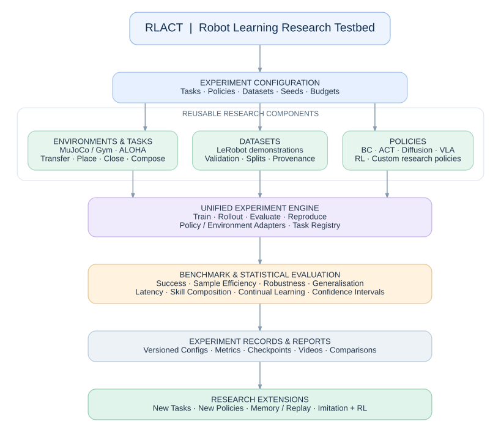

# RLACT

### A reproducible testbed for robot learning, multi-task manipulation, and compositional policies

RLACT is an open, modular research project for **training, evaluating, and comparing robot-learning policies under controlled conditions**. It begins with a working ALOHA bimanual cube-transfer simulation and is being developed into a reusable platform for manipulation benchmarks, multi-stage tasks, generalisation, sample-efficient learning, and continual learning.

> **Project status: early development (v0.1.0).** A pretrained ACT policy has successfully completed a cube-transfer rollout in MuJoCo. The RLACT package, task interface, ALOHA environment adapter, and initial contact-based reward logic are implemented and pass basic reset/initial-state checks. An end-to-end automated benchmark, repeated evaluations, additional tasks, and further policy baselines are **not yet validated**.

## System Architecture

RLACT is designed as a modular research platform
for reproducible robot learning experiments.

The architecture separates task definitions,
simulation environments, datasets, learning policies,
experiment execution, and statistical evaluation.



### Core Design Principles

- **Modularity:** Add tasks and policies independently.
- **Reproducibility:** Track configurations, seeds, datasets,
  checkpoints, and evaluation results.
- **Fair Comparison:** Evaluate policies using consistent
  scenarios, budgets, and statistical protocols.
- **Extensibility:** Support new robot-learning algorithms,
  environments, and research experiments.
- **Compositional Learning:** Evaluate individual skills,
  multi-task policies, and long-horizon task sequences.


## Vision

A new policy should be easy to evaluate on existing tasks. A new task should be easy to add without rewriting the evaluation engine. Every comparison should record its data, evaluation scenarios, training budget, compute, implementation version, and uncertainty.

RLACT aims to provide:

- **Strong baselines:** Behaviour Cloning (BC), Action Chunking Transformer (ACT), Diffusion Policy, and compatible vision-language-action (VLA) policies.
- **Extensible tasks:** single-skill manipulation, sequential tasks, reusable skill compositions, and new objects and scenes.
- **Fair evaluation:** common datasets and task definitions, matched evaluation conditions, documented budgets, and separate controlled-training and pretrained-model tracks.
- **Comprehensive metrics:** task success, efficiency, robustness, generalisation, action quality, inference cost, and statistical confidence.
- **Research extensibility:** imitation-to-RL refinement, experience replay, memory-guided learning, continual learning, and original policies.
- **Reproducibility:** versioned configurations, checkpoints, datasets, scenario seeds, episode-level records, and regression tests.

## Current milestone: ALOHA cube transfer

The first environment uses the original ACT ALOHA bimanual MuJoCo scene and a pretrained LeRobot ACT policy.

| Item | Current implementation |
| --- | --- |
| Robot | Simulated bimanual ALOHA / ViperX |
| Simulator | MuJoCo |
| Policy | `lerobot/act_aloha_sim_transfer_cube_human` |
| Demonstrations | `lerobot/aloha_sim_transfer_cube_human` |
| Policy action | 14 values: 6 joints + gripper per arm |
| MuJoCo control | 16 actuators, including paired gripper controls |
| Control rate | 50 Hz (10 physics steps at 0.002 s per step) |
| Episode horizon | 400 control steps (8 simulated seconds) |
| Visual input | Top RGB camera, 640 × 480 |
| Initial cube pose | `[0.2, 0.5, 0.05, 1, 0, 0, 0]` |

The original ACT transfer task assigns a maximum reward of **4** when the cube contacts the left gripper without touching the table. This contact-based definition has been added to the RLACT environment adapter. Initial-state testing returns reward 0 and success `False`; validation against a complete ACT benchmark rollout is the next milestone.

**Important:** A visually successful single rollout is not a measured success rate. RLACT will report aggregate performance only after automated, repeated evaluations are validated.

## Task roadmap

| Stage | Task family | Examples | Status |
| --- | --- | --- | --- |
| 1 | Atomic manipulation | Cube transfer | Working rollout; benchmark in progress |
| 2 | Additional atomic skills | Pick and place in box; close hinged box | Planned |
| 3 | Sequential manipulation | Transfer → place in box → close box | Planned |
| 4 | Compositional manipulation | Alternative valid orders, skill reuse, recovery, held-out combinations | Planned |
| 5 | Multi-task generalisation | New objects, positions, scenes, camera conditions, instructions | Planned |
| 6 | Continual and reinforcement learning | Learn tasks sequentially, retain prior skills, RL fine-tuning | Planned |

A task is defined by its scene, initial-state distribution, observations, action space, time limit, success/failure predicates, and evaluation variations. Task compositions additionally specify dependencies and valid transitions. **Compositional generalisation** requires held-out combinations, not just testing sequences already seen during training.

## Policy roadmap

| Track | Candidate policies | Comparison goal |
| --- | --- | --- |
| Sanity checks | Random / scripted / expert where available | Validate tasks and evaluation logic |
| Classical imitation | MLP or CNN BC | Establish a simple learning baseline |
| Chunked imitation | ACT | Action-chunking baseline |
| Generative imitation | Diffusion Policy | Compare trajectory generation |
| Pretrained foundation models | Compatible VLA models, such as SmolVLA | Evaluate pretrained transfer with provenance disclosed |
| Reinforcement learning | TD3, SAC, offline or imitation-to-RL methods where applicable | Study interaction and sample efficiency |
| Experimental | New architectures, replay, memory and continual-learning methods | Test research hypotheses against qualified baselines |

These are **candidate tracks**, not claims that every model currently runs in RLACT or is directly compatible with the same observation and action interfaces.

## Benchmark design

RLACT will maintain separate tracks for:

1. **Controlled training:** fixed datasets and splits, task definitions, scenario sets, and declared tuning/training budgets.
2. **Pretrained policy evaluation:** common evaluation conditions with explicit pretraining provenance and model-resource differences.
3. **Real-time deployment:** latency, deadline misses, control behaviour, and resource consumption on specified hardware.
4. **Multi-task and compositional learning:** per-skill and full-sequence success, held-out combinations, and recovery.
5. **Continual learning:** sequential task acquisition, retention, forgetting, and forward/backward transfer.

### Evaluation metrics

| Dimension | Planned measurements |
| --- | --- |
| Task completion | Success rate, stage success, maximum/final reward, timeouts, failure reasons |
| Sample efficiency | Success versus demonstrations or transitions, learning-curve AUC, data budget to threshold |
| Training cost | Wall-clock time, accelerator-hours, throughput, peak memory |
| Inference cost | p50/p95/p99 latency, deadline misses, throughput, model size |
| Manipulation quality | Placement error, grasp stability, action smoothness, joint limits, contacts |
| Robustness | Object perturbations, visual distractors, observation noise, dynamics changes, delays |
| Generalisation | Held-out positions, objects, scenes, task combinations |
| Long-horizon behaviour | Full-sequence success, conditional stage success, error propagation, recovery |
| Continual learning | Forgetting, retention, backward and forward transfer |
| Statistical confidence | Per-task confidence intervals, across-seed variation, IQM and probability of improvement where appropriate |

The benchmark will preserve **per-episode records** and use matched evaluation scenarios when comparing policies. Aggregation and uncertainty methods will be selected to match the metric and experimental design. We will not equate identical training steps with identical compute costs.

## Repository layout

The intended structure is shown below. **Not every directory contains implemented code yet.**

```text
RLACT/
├── configs/                 # Task, dataset, policy and experiment configs
├── src/rlact/               # Canonical installable Python package
│   ├── core/                # Interfaces, registries and shared utilities
│   ├── envs/                # MuJoCo / Gym environment adapters
│   ├── tasks/               # Task contracts and definitions
│   ├── policies/            # Policy adapters and experimental policies
│   ├── datasets/            # Dataset adapters and validation
│   ├── training/            # Training orchestration
│   ├── evaluation/          # Rollouts, metrics and statistics
│   ├── composition/         # Skill sequences and task graphs
│   └── tracking/            # Run metadata and experiment tracking
├── benchmarks/              # Task-specific benchmark assets/specifications
│   ├── transfer_cube/
│   ├── place_in_box/
│   ├── close_box/
│   └── sequential/
├── experiments/             # Research experiment definitions
├── scripts/                 # Working development and rollout scripts
├── tests/                   # Unit, integration and regression tests
├── docs/                    # Specifications and technical documentation
├── notebooks/               # Exploratory analyses
├── external/                # Local upstream repos; not committed
├── data/                    # Local datasets; not committed
├── outputs/                 # Videos, checkpoints and results; not committed
└── pyproject.toml           # Package configuration
```

The **canonical Python package lives in `src/rlact/`**. The root-level `rlact/` duplicate has been removed.

## Getting started (current development setup)

Current development has been validated on Windows with a Miniforge environment named `rlact`, Python 3.11, LeRobot 0.4.4, and MuJoCo 3.15.0. The working ACT rollout runs on CPU, although inference can be slow.

```bat
conda activate rlact
cd C:\Users\hoday\Documents\RLACT
python -m pip install -e . --no-deps
python -c "from rlact.envs.aloha_transfer import AlohaTransferTask; t=AlohaTransferTask(); print(t.reset()['cube_position']); print(t._task_reward()); t.close()"
```

This assumes the original ACT repository and XML scene already exist at `external/act/`. **It is not yet a clean-room installation guide:** the `pyproject.toml` currently does not declare all runtime dependencies, and the model/dataset may need downloading through LeRobot/Hugging Face. Reproducible setup instructions and dependency lockfiles are planned.

### Existing working demonstration

```bat
python scripts\rollout_act.py
```

This script uses the pretrained ACT checkpoint, renders the top camera, applies action chunks, and writes `outputs/act_rollout.mp4`. A successful cube-transfer rollout has been observed. It remains a development demonstration until the automated reward-based benchmark is verified.

### Next benchmark milestone

```bat
python scripts\benchmark_act_transfer.py
```

**Run this only after creating the proposed benchmark script.** The script is the next integration step and is not yet confirmed as present or validated in the repository.

## Development milestones

- [x] Create repository and installable `src/` package
- [x] Run pretrained ACT on ALOHA cube transfer in MuJoCo
- [x] Implement 14D policy-action to 16D actuator mapping
- [x] Add reusable task interface and ALOHA environment adapter
- [x] Implement original ACT contact-based reward logic; check initial state
- [ ] Validate automated ACT success detection over a complete rollout
- [ ] Add episode-level JSON/CSV results, videos and reproducible scenarios
- [ ] Validate benchmark parity and add regression tests
- [ ] Establish qualified BC, ACT and Diffusion Policy baselines
- [ ] Implement and validate box-placement and box-closing tasks
- [ ] Build sequential and compositional benchmarks
- [ ] Add robustness, generalisation and sample-efficiency suites
- [ ] Integrate compatible VLA and RL policies
- [ ] Investigate new sample-efficient and continual-learning algorithms

## Research principles

**Reuse before rewriting.** Prefer established LeRobot, MuJoCo, Gym and upstream policy implementations; write only the adapters, tasks and evaluation logic RLACT needs.

**Separate task, policy and evaluator.** Task success should be defined by the environment, not guessed from policy predictions or visual inspection.

**Qualify baselines before claiming improvements.** Check observation/action semantics, data provenance, reproducibility, inference behaviour, and statistical uncertainty.

**Distinguish working, validated and planned.** Keep this README aligned with what the code and tests actually demonstrate.

**Preserve reproducibility.** Record configuration, random seeds, versions, dataset and checkpoint identities, evaluation scenarios and raw episode outcomes.

## Upstream projects and resources

- [Hugging Face LeRobot](https://github.com/huggingface/lerobot)
- [LeRobot documentation](https://huggingface.co/docs/lerobot)
- [Original ACT implementation](https://github.com/tonyzhaozh/act)
- [Gym ALOHA](https://github.com/huggingface/gym-aloha)
- [MuJoCo](https://github.com/google-deepmind/mujoco)
- [MuJoCo Menagerie](https://github.com/google-deepmind/mujoco_menagerie)
- [rliable: Reliable Evaluation of Reinforcement Learning](https://github.com/google-research/rliable)

RLACT is an independent research project built using and learning from these upstream tools. Their respective licenses and model/dataset terms apply.

---

**Long-term objective:** A trustworthy research environment in which new tasks expand what can be tested, new policies expand what can be compared, and every reported improvement can be reproduced and scrutinised.
